# ThesisConnect

**A web-based thesis management and collaboration platform for university students.** Students can find thesis partners with matching research interests, form and manage thesis groups, share and review thesis documents, and talk to teammates in one place, instead of juggling Facebook groups, Discord and shared drives.

**Course:** CSE470 – Software Engineering, BRAC University (Spring 2026)
**Team (Section 08, Group 03):** Amiyo Bhowmik, Omar Faruk, Shabnam Sharmin Tarin, Shahinur Yeasmin

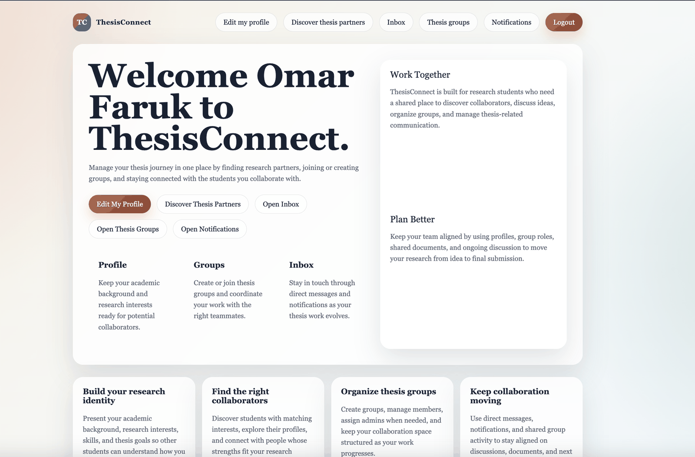

## Why ThesisConnect?

Finding thesis partners is hard. Students often settle for a group working on a topic they don't care about because there's no proper way to find people who share their interests. After the group forms, communication, file sharing and progress tracking are spread across many apps.

ThesisConnect brings the whole student side of thesis work into one system:
- **Discover** partners by research interest, skills, department and university, and see who is still looking for a group.
- **Form** thesis groups through join requests, invitations and admin roles.
- **Collaborate** on documents with visibility control, versioning and comments.
- **Communicate** through direct messages, group discussions, pinned messages and notifications.

The name comes from BRACU's own student portal, *Connect*.

## Features

| # | Requirement | Features |
|---|---|---|
| 1 | **User profile management** | Register and log in (JWT). Add department, university, academic details, research interests, skills, bio and profile picture. Mark yourself as *looking for a group*. Update or delete your profile. |
| 2 | **Student discovery and search** | Search students by name, research interest, department and university. Filter by email and clear filters. View full profiles. Show only students currently looking for a group. |
| 3 | **Thesis group creation and management** | Create a group with a topic and description. Browse all groups and their members. Send join requests, accept or reject invitations. Admins invite students, approve or reject requests, and can assign other admins. |
| 4 | **Communication** | Direct messages and group discussions. Notifications for messages, document feedback, invitations and admin changes. Pin and unpin direct and group messages. |
| 5 | **Document upload and collaboration** | Upload drafts, papers and reports as **public or private (group only)**. View and download them. Comment and give feedback. Upload new versions, with previous versions kept. |

## Screenshots

| | |
|---|---|
| 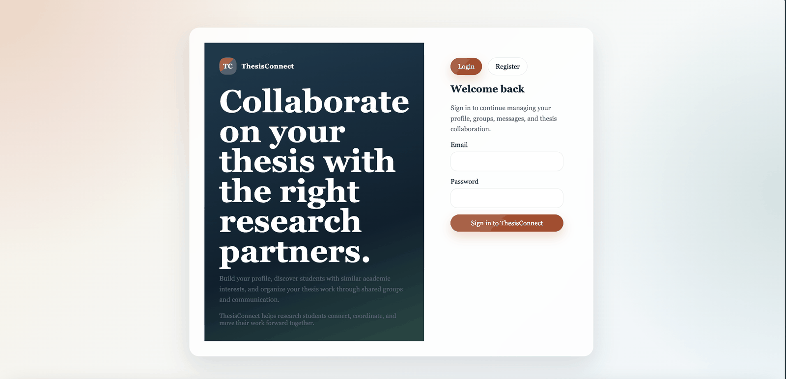<br><sub>Login / register</sub> | <br><sub>Dashboard</sub> |
| 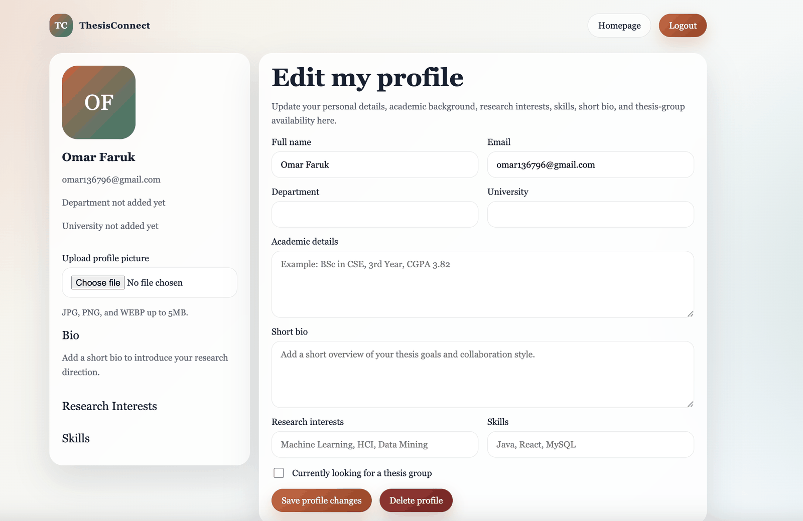<br><sub>New profile</sub> | 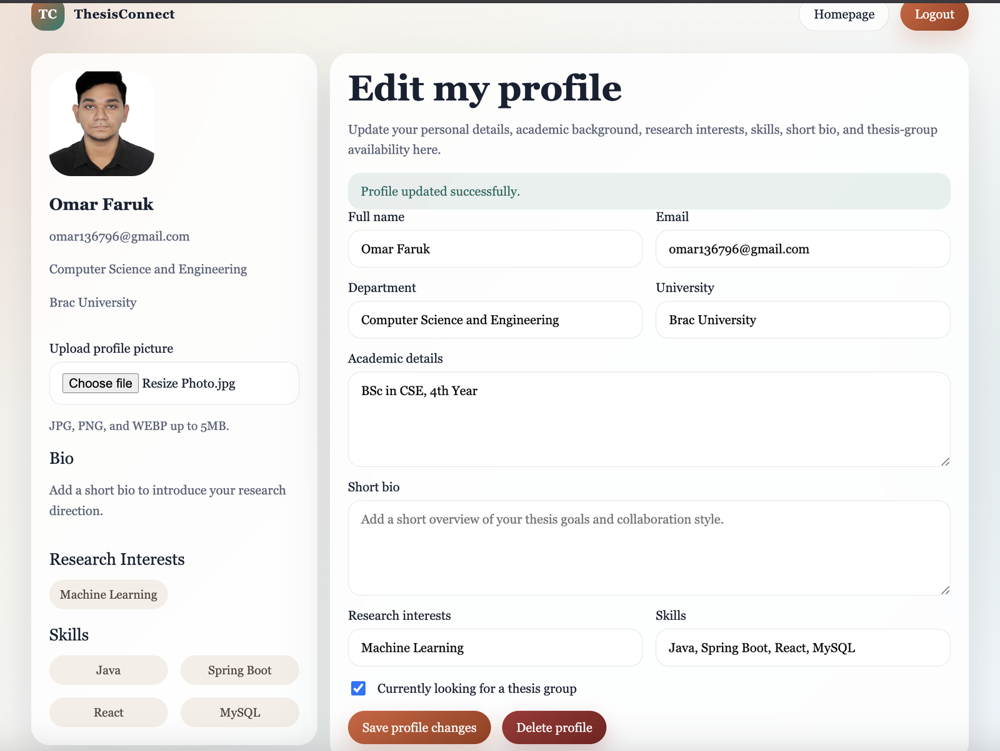<br><sub>Profile with interests, skills and picture</sub> |
| 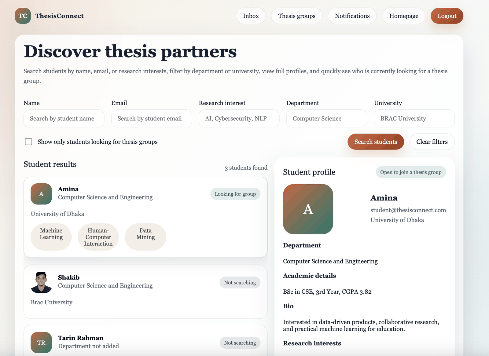<br><sub>Discover thesis partners</sub> | 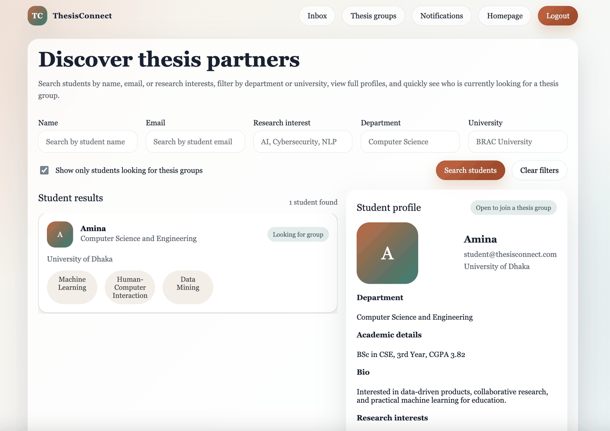<br><sub>Filter: only students looking for a group</sub> |
| 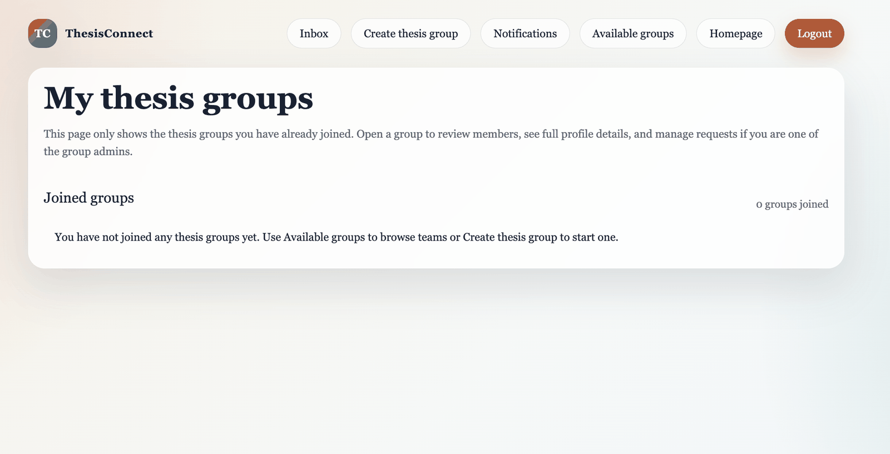<br><sub>My thesis groups (none yet)</sub> | 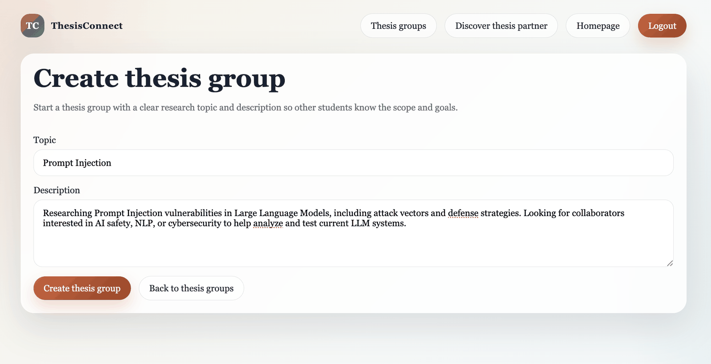<br><sub>Create a thesis group</sub> |
| 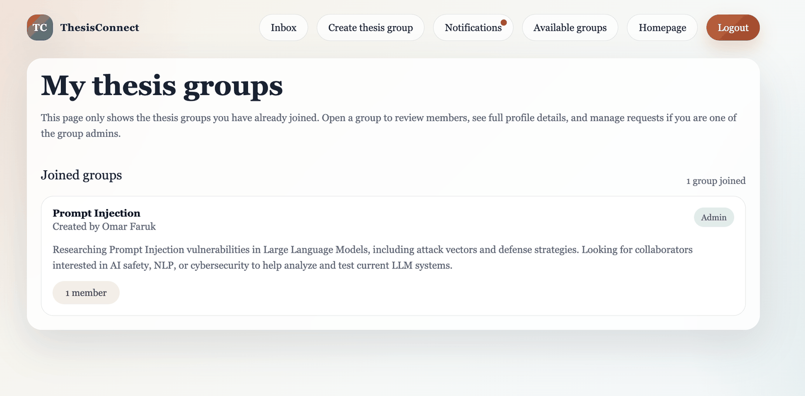<br><sub>My thesis groups after joining</sub> | 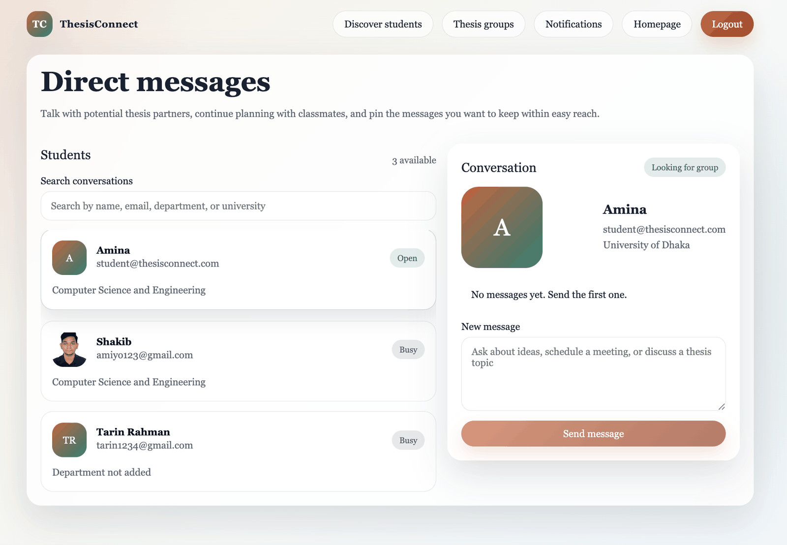<br><sub>Direct messages</sub> |
| 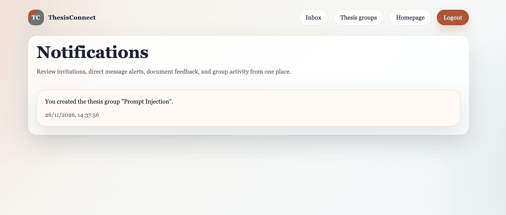<br><sub>Notifications</sub> | 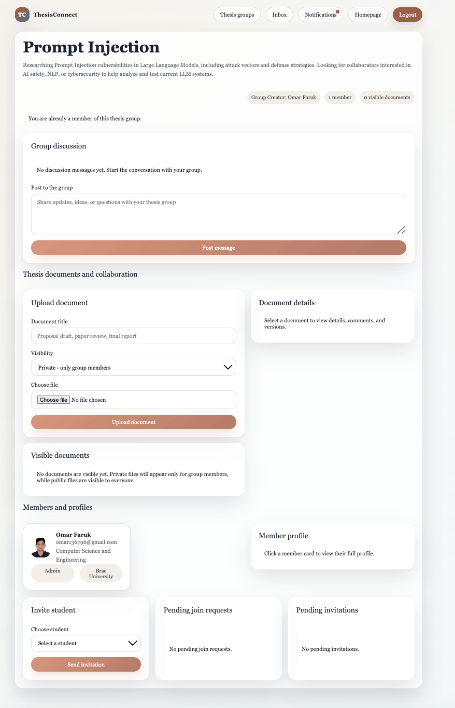<br><sub>Group page: discussion, documents, members, invitations</sub> |

## Tech stack

| Layer | Technology |
|---|---|
| Backend | Java 21, Spring Boot 4 (Web MVC, JDBC, Validation) |
| Security | Spring Security, JWT (OAuth2 resource server), BCrypt password hashing |
| Database | MySQL (H2 for tests) |
| Frontend | React 18 (JSX compiled in the browser with Babel), HTML and CSS, served as Spring Boot static resources |
| Build | Maven (wrapper included) |
| Workflow | Git and GitHub: feature branches and pull requests (`feature/…`, `bugfix/…`, `docs/…`) |

## Architecture

The backend follows a layered MVC design:

```
web/          REST controllers (auth, profile, groups, documents, messages) and page routes
service/      Business logic: auth, JWT, profiles, groups, documents, communication
repository/   Data access with Spring JDBC and hand-written SQL
domain/       Core models: User, ThesisGroup, JoinRequest, Document, DocumentVersion,
              Comment, Message, GroupMessage, Notification
dto/          Request and response objects for the API
config/       Spring Security, JWT and web (upload folder) configuration
```

### Class diagram

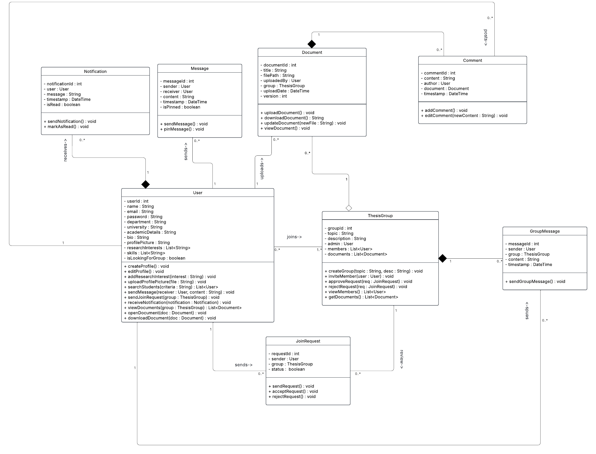

The class diagram is also in [PDF](docs/diagrams/Class_Diagram.pdf), with a [list of every class's attributes and operations](docs/diagrams/Classes_Attributes_Operations.pdf).

### Database

MySQL with 14 tables, created automatically from `src/main/resources/schema.sql` on startup:
`users`, `user_research_interests`, `user_skills`, `thesis_groups`, `group_members`, `join_requests`, `notifications`, `documents`, `document_versions`, `comments`, `direct_messages`, `group_messages`, `direct_message_pins`, `group_message_pins`.

### REST API overview

| Area | Endpoints |
|---|---|
| Auth | `POST /api/auth/register`, `POST /api/auth/login` |
| Profile | `GET/PUT/DELETE /api/profile/me`, `POST /api/profile/me/picture`, `GET /api/profile/students` (search), `GET /api/profile/students/{id}` |
| Groups | `GET/POST /api/groups`, `GET /api/groups/{id}`, join requests, invitations, approve or reject, assign or remove admin |
| Documents | Upload, upload a new version, comment, download: `/api/groups/{id}/documents/…` |
| Messages | Direct and group messages with pin and unpin: `/api/messages/direct/…`, `/api/messages/groups/…` |
| Notifications | `GET /api/groups/notifications`, `GET …/unread`, `POST …/read` |

## Running locally

### Prerequisites
- **Java 21** or newer
- **MySQL 8+** running locally
- Maven is optional, because the wrapper (`mvnw`) downloads it

### 1. Create the database
```sql
CREATE DATABASE thesisconnect;
```
The tables are created automatically when the app starts.

### 2. Check the connection settings
`src/main/resources/application-mysql.properties` points to `localhost:3308` with user `root` and an empty password. The default MySQL port on most machines is **3306**. You can either change the file, or pass your own settings when running, as below.

### 3. Run
macOS / Linux:
```bash
./mvnw spring-boot:run
```
Windows:
```bash
mvnw.cmd spring-boot:run
```

With a different port or password:
```bash
./mvnw spring-boot:run -Dspring-boot.run.arguments="--spring.datasource.url=jdbc:mysql://localhost:3306/thesisconnect --spring.datasource.password=YOUR_PASSWORD"
```

### 4. Open
Go to **http://localhost:8080**, register an account, and start exploring. Use a second browser profile or a private window to test groups and messaging with another user.

**Notes**
- Uploaded profile pictures go to `uploads/profile-pictures`, and documents to `uploads/thesis-documents`. The size limit is 5 MB, set in `application.properties`.
- The JWT secret in `application.properties` is a development value. Change it before any real deployment.

## Team and contributions

| Member | Main contributions |
|---|---|
| **Amiyo Bhowmik** | Project setup and configuration. Registration, login, Spring Security and JWT. User schema and repository. Document upload and download, versioning and comments (API and UI). Database fixes. |
| **Omar Faruk** | Profile management: view and update API, profile picture upload, interests, skills and bio, profile deletion. Thesis group creation: schema, domain, DTOs, repository, service, controller and UI. Group details and member profile views. Pinned-message and notification updates. Code review and merging of pull requests. |
| **Shabnam Sharmin Tarin** | Student search and discovery (backend filters and UI). Join requests and invitation responses. Admin invite, approve and reject flows, and admin assignment. Tests for the group admin workflow. |
| **Shahinur Yeasmin** | Direct messaging and group discussions (schema, endpoints, UI). Page routing and the logged-in home page. Selected-student profile panel. Per-user pin tables. Notifications for document feedback. |

## Project documents

- [Project report / proposal](docs/Project_Report.pdf): background, scope, objectives, approach, requirements
- [Final feature list](docs/Updated_Features.pdf)
- [Class diagram](docs/diagrams/Class_Diagram.pdf) and [classes, attributes and operations](docs/diagrams/Classes_Attributes_Operations.pdf)

## Future work

- Real-time messaging with WebSockets, instead of refreshing.
- Supervisor / faculty accounts to review and approve thesis groups.
- Partner recommendations based on matching interests and skills.
- Deployment, with a production build of the frontend.
